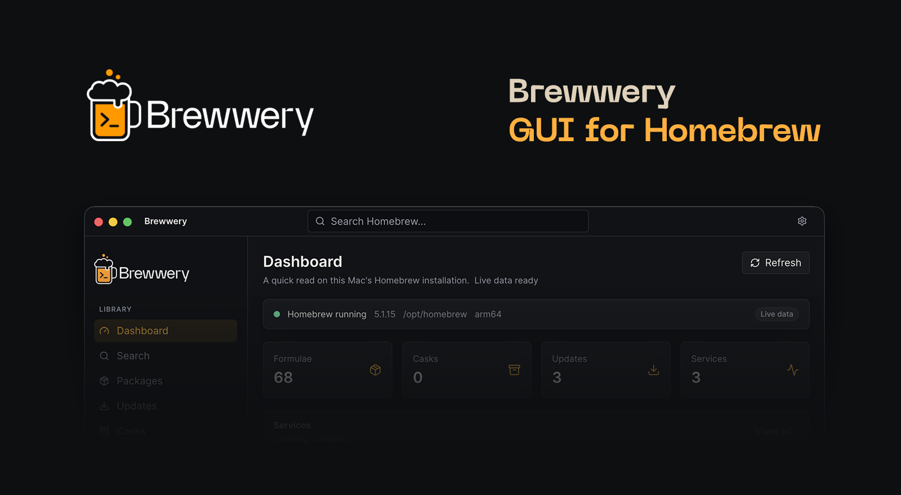

# Brewwery Docs

Documentation site for [Brewwery](https://www.brewwery.com) — the native macOS app for Homebrew.

The docs cover installing and updating Brewwery 1.1.1, Homebrew basics and commands, troubleshooting, the security model, the Swift architecture, and development and release workflows.

Hosted at [docs.brewwery.com](https://docs.brewwery.com).

[by Made Büro](https://github.com/madeburo)



## Stack

- [Next.js 16.4.3](https://nextjs.org)
- [Nextra 4.6.1](https://nextra.site) (docs theme)
- React 19.3.1 and TypeScript 6 (compatible with Nextra’s Twoslash dependency)
- Pagefind 1.5.2 for full-text search
- Swift app screenshots in `public/screenshots`

## Development

Use Node.js 20.9 or later (production uses Node.js 24 LTS).

```bash
npm ci
npm run dev
```

Open [http://localhost:3000](http://localhost:3000).

## Build

```bash
npm run build
```

Pages are prerendered into `.next/`. The `postbuild` script indexes the rendered documentation into `public/_pagefind/`; these generated files are required for search and are not committed. Serve the build with `npm start`.

```bash
npm run typecheck
npm audit
```

The Zod, KaTeX, and XML parser overrides pin patched transitive dependencies used by Nextra. Keep them until upstream dependency ranges include the fixes, and verify both the build and search when changing them. The docs package version is independent of the native app version.

`npm ci` applies `patches/nextra-theme-docs+4.6.1.patch` automatically. It makes the theme’s layout children schema optional, matching [upstream fix #5037](https://github.com/shuding/nextra/pull/5037): the layout removes `children` before validating its configuration, which otherwise fails with patched Zod versions. Remove the patch after an upstream release includes the fix.

## Structure

```
docs/
├── app/                    # Next.js App Router layout
│   ├── layout.tsx          # Root layout (html, head, body)
│   └── [[...mdxPath]]/    # Catch-all route
│       ├── layout.tsx      # Nextra docs layout (navbar, sidebar, footer)
│       └── page.tsx        # MDX page renderer
├── content/                # MDX documentation pages
│   ├── _meta.ts            # Sidebar navigation order
│   ├── index.mdx           # Introduction
│   ├── getting-started.mdx
│   ├── features.mdx
│   ├── what-is-homebrew.mdx
│   ├── brew-commands.mdx
│   ├── troubleshooting.mdx
│   ├── security.mdx
│   ├── architecture.mdx
│   ├── development.mdx
│   ├── roadmap.mdx
│   ├── changelog.mdx
│   ├── faq.mdx
│   └── contributing.mdx
├── public/                 # Static assets
│   ├── screenshots/        # App screenshots (dark and -Light variants)
│   └── og-image.png        # Open Graph image for social sharing
├── mdx-components.tsx      # MDX component configuration
├── next.config.mjs         # Next.js + Nextra config
├── tsconfig.json
└── package.json
```

## Deployment

Install with `npm ci`, build with `npm run build`, and serve with `npm start -- -p 3089` behind the `docs.brewwery.com` domain. On Hetzner the checkout is `/var/www/brewwery/docs` and the PM2 process is `brewwery-docs`. Build and verify the new release before restarting the process, including the generated `public/_pagefind/` assets.

Publish release documentation only after the corresponding signed, notarized DMG is available. The website owns `appcast.xml` and the download; this repository documents their behavior but does not generate or sign updates.

Screenshots come from `Scripts/screenshots.sh` in the [app repository](https://github.com/brewwery/brewwery); copy the generated PNGs into `public/screenshots/`.

## Repository

[github.com/brewwery/docs](https://github.com/brewwery/docs)

## License

MIT
